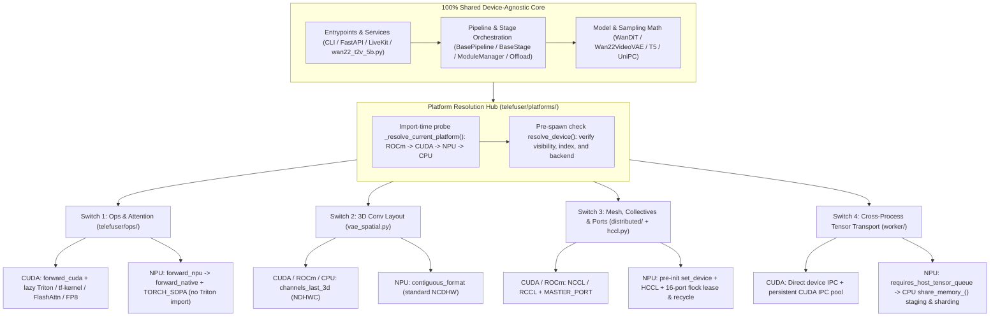

# Hardware Platforms

TeleFuser abstracts execution hardware behind the platform layer in `telefuser/platforms/`. Each process resolves a
single `current_platform` object at import time, and the [Ops](ops.md) dispatch layer uses it to select operator
implementations. Pipelines and examples configure a `torch.device`-style device and do not branch on the vendor.

## Platform selection

`_resolve_current_platform()` in `telefuser/platforms/__init__.py` probes the environment in a fixed order and
instantiates the first match:

1. **ROCm** — a PyTorch `+rocm` (HIP) build with at least one visible AMD GPU
2. **CUDA** — a CUDA build with at least one visible NVIDIA GPU
3. **NPU** — a `torch_npu` installation with a visible Ascend device
4. **CPU** — the fallback when no accelerator is detected

HIP builds expose the `torch.cuda` API, so the ROCm platform reuses it (`device_type` stays `cuda`); check
`torch.version.hip` to distinguish a ROCm host from an NVIDIA one. A HIP or CUDA build without a visible GPU falls
back to CPU. `CUDA_VISIBLE_DEVICES` controls device visibility on both GPU platforms, and
`ASCEND_RT_VISIBLE_DEVICES` on NPU.

## Cross-device sharing and dispatch boundaries

Entry points, pipeline orchestration, stage state machines, diffusion schedulers, CPU offload, and DiT / VAE / T5 model
definitions share one codebase across platforms. Hardware-specific behavior is isolated behind `current_platform` and
four explicit runtime boundaries:

| Switch boundary | Unified interface | CUDA / ROCm path | Ascend NPU path |
| --- | --- | --- | --- |
| **1. Operators & attention** | `CustomOp`, `CustomOpFunction`, attention registry | Eager dispatches to `forward_cuda` / `forward_rocm`; `kernel/triton/*` and `tf-kernel` load lazily on use | Prefers `forward_npu`, otherwise falls back to `forward_native` and `TORCH_SDPA` with zero Triton dependency |
| **2. VAE 3D conv layout** | `conv3d_activation_layout(tensor)` | `torch.channels_last_3d` for cuDNN 3D convolutions | `torch.contiguous_format` (NCDHW) to satisfy CANN contiguous memory rules |
| **3. Collectives & ports** | `create_device_mesh_from_config`, `PipelineP2PComm`, `ParallelWorker` | `device_type="cuda"`, `nccl` backend, `MASTER_PORT` allocation | `device_type="npu"`, pre-init `set_device`, `hccl` backend + `reserve_hccl_ports()` 16-port `flock` lease |
| **4. Worker tensor queues** | `requires_host_tensor_queue(device_type)` | `False`: direct device IPC queues and `_CudaIpcPayload` zero-copy pool | `True`: bidirectional host staging via `share_memory_()` across ordinary queues and `WorkerTensorChannel` |

## Platform matrix

| Platform | `device_type` | Distributed backend | Operator dispatch | `tf-kernel` | torch.compile |
|----------|---------------|---------------------|-------------------|-------------|---------------|
| CUDA (NVIDIA) | `cuda` | NCCL | Optimized `forward_cuda` paths | Supported | Experimental ([details](torch_compile_compatibility.md)) |
| ROCm (AMD) | `cuda` | RCCL (`nccl`) | Triton `forward_cuda` paths and native fallbacks | Not available | Not validated |
| NPU (Ascend) | `npu` | HCCL | Native fallbacks | Not available | Not validated |
| CPU | `cpu` | Gloo | Native fallbacks | Not available | Native path |

## Attention backends by platform

Attention backend availability is resolved at import time (see [Attention](attention.md)). A backend whose
dependencies are missing falls back to `TORCH_SDPA` with a one-time warning.

- **CUDA**: all dense backends — `TORCH_SDPA`, FlashAttention 2/3/4, SageAttention through `tf-kernel` or
  `sageattention`, and cuDNN — subject to GPU architecture; sparse backends likewise.
- **ROCm**: `TORCH_SDPA` only. `flash_attn` has no official ROCm wheels for consumer RDNA GPUs, and `tf-kernel`,
  SageAttention, and SpargeAttn are CUDA-only. The AOTriton-backed SDPA path is the fast attention kernel on
  RDNA4.
- **NPU / CPU**: `TORCH_SDPA` through the native fallback paths; no vendor attention kernels are integrated.

## CUDA

CUDA is the primary validated path: Python 3.10–3.13, PyTorch 2.6 or newer, CUDA toolkit 12.8 or newer, with H100
as the validated target for optimized kernels. Optional `tf-kernel` provides fused elementwise operations,
quantized GEMM, SageAttention, and block-sparse attention — see [tf-kernel](tf_kernel.md) for build and artifact
compatibility. Multi-GPU inference uses NCCL; see [Parallel Inference](parallel.md).

## ROCm

ROCm support targets AMD GPUs with ROCm 7.x and a PyTorch `+rocm` build; see [Installation](installation.md) for the
setup path.

- Attention uses `TORCH_SDPA`; no `tf-kernel`, `flash_attn`, or `sageattention` installation is required.
- The ops layer selects `forward_rocm` where a kernel defines one and otherwise reuses the CUDA Triton path (Triton
  supports ROCm), falling back to native PyTorch.
- `tf-kernel` imports are gated to `CudaPlatform`, so no CUDA-only extension is loaded on ROCm hosts.
- Multi-GPU inference uses RCCL, AMD's NCCL-compatible collectives library. PyTorch's ROCm build exposes it through
  the `nccl` backend string, so the platform layer requires no special configuration.
- `torch.compile` is not validated on ROCm; ROCm examples run eager.
- Validated entry points are the `*_rocm.py` examples, for example
  [Wan2.1 1.3B text-to-video](https://github.com/Tele-AI/TeleFuser/tree/main/examples/wan_video) on a Radeon RX 9070
  (gfx1201, ROCm 7.2). Multi-GPU branches reuse the `_h100.py` parallel configuration but are not yet validated.

## NPU and CPU

The NPU platform targets Huawei Ascend devices through `torch_npu` with the HCCL distributed backend.

- Attention uses `TORCH_SDPA` through the native fallback paths; no `tf-kernel`, `flash_attn`, `sageattention`, or
  `triton` installation is required.
- The ops layer selects `forward_npu` where an op defines one and otherwise falls back to native PyTorch. No
  NPU-optimized kernels are integrated yet, so pipelines run entirely on the native paths.
- Multi-rank NPU workers bind the visible device ID before initializing HCCL. Their ordinary queues and direct tensor channels stage NPU payloads through host memory. Each live HCCL worker group reserves its own 16-port block.

| Device / host | Workload and mode | Cards | Software and qualification |
| --- | --- | --- | --- |
| Atlas 910B2 64 GB | Wan2.2 TI2V-5B offline T2V, eager BF16 / SDPA / UniPC, model CPU offload | 1, 2, 4 | CANN 8.2, `torch` 2.9.0, `torch_npu` 2.9.0.post1; validated on 1, 2, and 4 cards. |
| Atlas 910B2 64 GB / Linux arm64 | Same recipe | 1, 2 | CANN 9.3.0-beta.1, `torch` 2.11.0+cpu, `torch_npu` 2.11.0.post4; 1- and 2-card runs produced 121 pixel-identical frames. Container deployment defaults to `quay.io/ascend/vllm-omni:v0.34.0` (CANN 9.3.0). [Container guide](ascend_910b.md) |

NPU qualification for I2V, A14B, serving, streaming, cross-host inference and `torch.compile` is pending.

The CPU platform is the fallback when no accelerator is detected; it is intended for tests and for pipelines that
explicitly request CPU execution.
